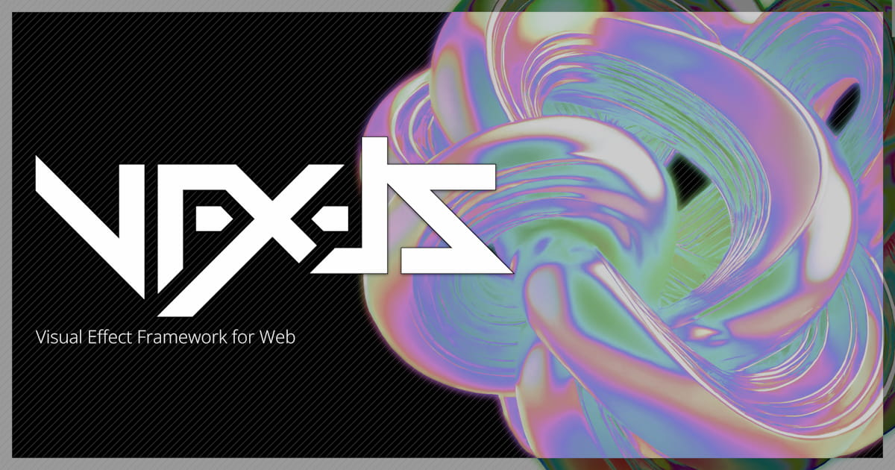

<div align="center">
  <a href="https://amagi.dev/vfx-js/" target="_blank"></a>
  <h1>@vfx-js/react: WebGL effects for React elements!!</h1>
  <br/>
  <br/>
</div>

## Install

```
npm i @vfx-js/core @vfx-js/react
```

## Usage

@vfx-js/react exports `VFXImg`, `VFXVideo`, `VFXSpan` and `VFXDiv`.
These components works just like ``, `<video>`, `<span>` and `<div>` - accepts all properties they have, but they are rendered in WebGL world with shader effects!

```ts
import * as VFX from '@vfx-js/react';

export default () => (
    <>
        {/* Render image with shader */}
        <VFX.VFXImg src="cat.png" alt="image" shader="rgbShift"/>

        {/* It also supports animated GIFs! */}
        <VFX.VFXImg src="doge.gif" shader="pixelate"/>

        {/* and videos! */}
        <VFX.VFXVideo src="mind_blown.mp4"
            autoplay playsinline loop muted
            shader="halftone"/>

        {/* Render text as image, then apply the shader effect! */}
        <VFX.VFXSpan shader="rainbow">Hi there!</VFX.VFXSpan>

        {/* Or even inputs! */}
        <VFX.VFXDiv shader="rainbow">
            <input type="text" value="hello" />
        </VFX.VFXDiv>
    </>
);
```

NOTE: `VFXSpan` doesn't work if the content includes child nodes.

```ts
// OK
<a href="https://example.com"><VFXSpan>Yo</VFXSpan></a>

// NG: link styles are not rendered correctly
<VFXSpan><a href="https://example.com">Yo</a></VFXSpan>
```

### VFXCanvas

`VFXCanvas` renders its children into a shader with html-in-canvas, and falls back to a `<div>` with dom-to-canvas when the browser doesn't support it.

```ts
<VFXCanvas shader="rainbow">
    <h1>Hello</h1>
    <input type="text" />
</VFXCanvas>
```

NOTE: With SSR, `VFXCanvas` renders a `<div>` first and switches to `<canvas>` after hydration, so its children mount again once.

### Options

All VFX components outside `<VFXProvider>` share one WebGL canvas.
Use `useVFXConfig` to set its options:

```ts
import { useVFXConfig, VFXImg } from '@vfx-js/react';

export default () => {
    useVFXConfig({ pixelRatio: 1, zIndex: -1 });
    return <VFXImg src="cat.png" shader="rgbShift"/>;
};
```

- Options: `pixelRatio`, `zIndex`, `postEffect`.
- A change in options recreates the canvas, so memo `postEffect` (e.g. with `useMemo`).
- Options apply while the component is mounted. Call it once, e.g. in your root layout. If more than one is mounted, the last one wins.

### VFXProvider

Use `<VFXProvider>` when you need a separate VFX instance, e.g. to put the canvas in a `wrapper` element, or to access the instance through `VFXContext`:

```ts
import { useRef } from 'react';
import { VFXProvider, VFXImg } from '@vfx-js/react';

export default () => {
    const wrapper = useRef<HTMLDivElement>(null);
    return (
        <div ref={wrapper} style={{ position: 'relative', overflow: 'hidden' }}>
            <VFXProvider wrapper={wrapper} pixelRatio={1}>
                <VFXImg src="cat.png" shader="rgbShift"/>
            </VFXProvider>
        </div>
    );
};
```

Props:

- `pixelRatio`, `zIndex`, `postEffect`: same as `useVFXConfig`.
- `wrapper`: a ref to the element the canvas is appended to. The element should have `position: relative` and `overflow: hidden`.
- `autoplay` (default `true`): set `false` to drive rendering yourself.

Components inside a Provider use its instance. `useVFXConfig` does nothing there.
Each Provider has its own canvas, separate from the shared one. So a page with a Provider and components outside it has two canvases.

#### Accessing the instance

`VFXContext` holds the Provider's `VFX` instance. Use it with `autoplay={false}` to render frames yourself:

```ts
import { useContext, useEffect } from 'react';
import { VFXContext, VFXProvider, VFXImg } from '@vfx-js/react';

const Renderer = () => {
    const vfx = useContext(VFXContext);
    useEffect(() => {
        if (!vfx) return;
        let id = requestAnimationFrame(function loop() {
            vfx.render();
            id = requestAnimationFrame(loop);
        });
        return () => cancelAnimationFrame(id);
    }, [vfx]);
    return null;
};

export default () => (
    <VFXProvider autoplay={false}>
        <Renderer />
        <VFXImg src="cat.png" shader="rgbShift"/>
    </VFXProvider>
);
```

`VFXContext` is `null` outside a Provider, and while the Provider is creating its instance.

### Effect API

Pass a prebuilt `Effect` instance (or array) from [`@vfx-js/effects`](https://www.npmjs.com/package/@vfx-js/effects) via the `effect` prop:

```ts
import * as VFX from '@vfx-js/react';
import { BloomEffect, PixelateEffect } from '@vfx-js/effects';

export default () => (
    <>
        <VFX.VFXImg src="cat.png" effect={new BloomEffect({ intensity: 5 })}/>

        <VFX.VFXImg src="doge.gif" effect={[
            new PixelateEffect({ size: 10 }),
            new BloomEffect({ intensity: 8 }),
        ]}/>
    </>
);
```

When only the `effect` prop changes between renders, the chain is swapped in-place without re-uploading the source texture or re-initializing effects whose reference is unchanged.

### Custom Shader

```ts
import { VFXSpan } from '@vfx-js/react';

const blink = `
uniform vec2 resolution;
uniform vec2 offset;
uniform float time;
uniform sampler2D src;
out vec4 outColor;

void main() {
    vec2 uv = (gl_FragCoord.xy - offset) / resolution;
    outColor = texture2D(src, uv) * step(.5, fract(time));
}
`;

export default = () => (
    <VFXSpan shader={blink}></VFXSpan>
);
```

<!-- #### Passing Uniforms

```ts
type Uniform = THREE.IUniform | number | number[];

type UniformObject = {
    [name: string]: THREE.IUniform;
}

type Uniforms = UniformObject | () => UniformObject;
```

```ts
import React, { useState } from 'react';

export default () => {
    const [count, setCount] = useState(0);

    return (
        <VFXImg src="main_texture.png"
            uniforms={{
                foo: [1, 2, 3], // vec3
                foo: [1, 2, 3], // vec3
                foo: [1, 2, 3] // vec3
            }}/>

        <button type="button" onClick={() => setCount(count + 1)}>
        <VFXImg src="main_texture.png"
            shader={animated}
            uniforms={{ count }}/>
    );
};
```

### Textures

```ts
<VFXImg src="main_texture.png" textures={["tex1.png", "tex2.png"]}/>
```

```glsl
uniform sampler2D input;
uniform sampler2D texture1;
uniform sampler2D texture2;
``` -->

## Page transitions

`VFXTransition` animates between pages with a shader.
See [TRANSITION.md](../../docs/TRANSITION.md) for the full API.

### React Router

Import `VFXTransition` from `@vfx-js/react/react-router` and use it in
place of `<Outlet />`. Each pathname is one page.

```tsx
import { VFXTransition } from "@vfx-js/react/react-router";
import { Crossfade } from "@vfx-js/transitions";

function Layout() {
    return (
        <>
            <nav>...</nav>
            <VFXTransition transition={Crossfade} />
        </>
    );
}
```

- It takes the same props as `VFXTransition` without `children`.
  `pageKey` defaults to the pathname, so a search-only change does not run.
- The old page keeps its own route while it animates out:
  `useParams`, `useMatches` and nested outlets stay on the old route.
  `useLocation()` inside the old page reads the new location.
- Back plays the same spec as forward. Pass `autoReverse` to play the spec
  that entered the page, reversed. It needs the Navigation API.
- `react-router` 7 is an optional peer dependency.

## Future work

-   Passing custom uniforms
-   Passing custom textures

## Author

[AMAGI](https://twitter.com/amagitakayosi)

## LICENSE

MIT
